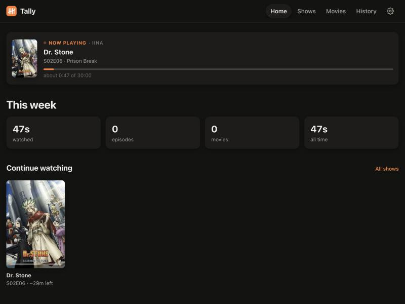

# Tally

A small app that runs quietly on your Mac or Windows PC and keeps a log of everything you watch.

- **Automatic.** Open a video and Tally records the date, time and how far you got.
- **Understands messy names.** `Show.S02E05.1080p.mkv`, `[SubsPlease] Frieren - 12 (1080p).mkv`, `Season 2/05 - Pilot.mkv` and `Inception.2010.1080p.BluRay.x264.mkv` all become a real title, season and episode.
- **Posters and descriptions.** Shows come from TVmaze. Movies come from IMDb and Wikipedia, or from TMDB if you add a free key.
- **History you keep.** Deleting the video file doesn't delete its history.
- **A clean page to browse:** what you watched this week, shows you're partway through, what episode you're on, and full searchable history.
- **One local file.** Everything, including the posters, lives in a single SQLite file on your computer. Nothing is uploaded.



## Install

You need Python 3.9 or newer. macOS includes it, or you can get it from python.org. On Windows, install it from python.org. Tally uses only the standard library, so there's nothing else to install.

From this folder:

```bash
python3 -m tally install
```

On Windows, use `py -m tally install`.

`install` does three things:

1. **Sets up your players** so they report your exact position (see below).
2. **Starts Tally in the background**, now and every time you log in: a LaunchAgent on macOS, a hidden Startup item on Windows.
3. **Opens your history** at <http://127.0.0.1:8737/>.

Bookmark that page. Tally has no window or dock icon; it just runs.

## How each player is hooked up

| Player | How Tally knows what's playing | Progress |
| --- | --- | --- |
| **IINA** (Mac) | Adds the mpv option `input-ipc-server` in IINA's advanced settings. **Quit and reopen IINA once** after installing. | exact |
| **mpv** | Adds `input-ipc-server=…` to `mpv.conf` | exact |
| **VLC** | Turns on VLC's web interface on `127.0.0.1:8089` with a password. Restart VLC once. | exact |
| **MPC-HC / MPC-BE** (Windows) | Turns on the localhost web interface (port 13579). Restart the player once. | exact |
| QuickTime, Infuse, PotPlayer, Movies & TV, others | Notices the video file the player has open | estimated from time open and the episode's runtime |

The fallback in the last row also covers IINA and VLC before you've restarted them. On Windows, `pip install psutil` lets the fallback see full file paths. Without it, the fallback reads file names from window titles.

Settings (gear icon) shows which players Tally is connected to right now.

To undo the player changes, run `python3 -m tally setup --undo`.

## Using it

- **Home:** what's playing now, this week's totals, *Continue watching* (partly watched episodes and movies, plus your next episode), and everything you watched this week by day.
- **Shows:** every show with your current episode and progress (`29/94`).
- **Show page:** the full episode list, organized by season. Tick episodes to mark them watched, or use **⋯ → Mark all up to here** to catch up on episodes you watched elsewhere.
- **Fix match:** if a file was matched to the wrong show or movie, open it and choose **Fix match**. Every logged file moves to the title you pick.
- **History:** search across titles, episode names and file names. You can remove entries or mark them finished.

An episode or movie counts as **finished** once you reach 90% of it, or the last 2 minutes of anything longer than 10 minutes. If you reopen the same file within an hour, Tally continues the same entry. Files open for less than 20 seconds aren't logged.

## Commands

```text
python3 -m tally install      set up players, start now and at login, open the page
python3 -m tally status       what Tally sees right now (players, what's playing)
python3 -m tally open         open the page
python3 -m tally stop         stop the background app
python3 -m tally uninstall    stop starting at login (add --players to undo player settings)
python3 -m tally setup        configure players only (--undo to reverse)
python3 -m tally run          run in the foreground (--port N, --lan, -v)
python3 -m tally parse NAME   show how a file name is understood
```

## Your data

| | macOS | Windows |
| --- | --- | --- |
| Database (history, posters, settings) | `~/Library/Application Support/Tally/tally.db` | `%APPDATA%\Tally\tally.db` |
| Log | `…/Tally/tally.log` | `%APPDATA%\Tally\tally.log` |

Back up that one file to keep your history. **History → Export JSON** saves everything as JSON.

### On your phone

To browse from your phone on the same Wi-Fi, run `python3 -m tally run --lan` and open `http://<your-computer's-IP>:8737/` on the phone. The page works at phone size. Only do this on a network you trust; there's no login.

## Development

```bash
python3 -m unittest discover -s tests -t .
python3 -m tally run --port 8799 -v     # try changes without touching the background copy
```

The background service runs from a copy in `~/Library/Application Support/Tally/app`. macOS doesn't let login items read `~/Documents` without a permission prompt, which is why it uses a copy. After you change the code, run `python3 -m tally install` again to update the copy.

| File | What it does |
| --- | --- |
| `tally/parser.py` | File name → title, year, season, episode |
| `tally/metadata.py` | TVmaze, TMDB, IMDb and Wikipedia lookups |
| `tally/matcher.py` | Background worker that matches titles and maps absolute anime episode numbers to seasons |
| `tally/players/` | One source per player, plus the open-file fallback |
| `tally/tracker.py` | Turns "what's playing" snapshots into history rows |
| `tally/api.py`, `tally/server.py` | JSON API and the local web server |
| `tally/web/` | The browse page (plain HTML, CSS and JS) |
| `tally/service.py`, `tally/setup_players.py` | Start at login, player configuration |
